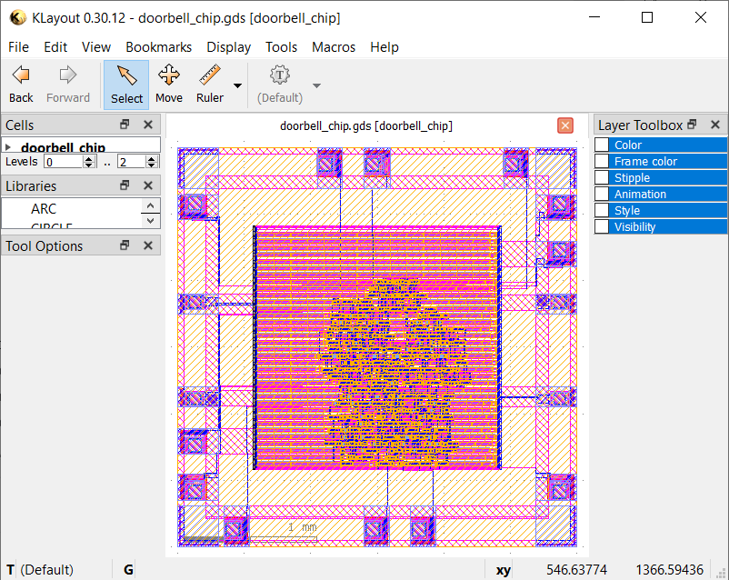

# Doorbell ASIC v2: synthesis to GDS on SCL CP8D (0.8 um)

> **Current signoff status (2026-11-24):** SCL DRC and LVS pass on the promoted GDS. See [SIGNOFF_STATUS.md](SIGNOFF_STATUS.md) for timing checks and caveats, [NEXT_AGENT_HANDOFF.md](NEXT_AGENT_HANDOFF.md) for continuation notes, and [verify/SIGNOFF_FIX_NOTES.md](verify/SIGNOFF_FIX_NOTES.md) for the layout fixes. Failure descriptions below are historical investigation notes.

A clean restart of the flow, built from the scripts that worked in the first
attempt plus the fixes found by reviewing it (see SIGNOFF_HANDOFF.md and NEXT_AGENT_HANDOFF.md).
Everything runs through one command: `./run.sh <stage>`. Each stage checks its
inputs, writes `logs/<stage>.log`, and stops with the error if it fails.

## Before you start
- SCL CP8D PDK at `~/PDKs/scl_cp8d` (override with `PDK_ROOT=...`)
- Reference repo cloned at `~/apb-rtl-to-gds-scl-cp8d` (config and streamout come from it)
- Supplied SCL 3 mm pad-frame GDS at `../frame_work/Padframe_database/pad_frame_gds/frame3mmx3mm.gds` (override with `FRAME_GDS=...`)
- OpenROAD and Yosys paths are set at the top of `run.sh`; KLayout is the `klayout` in PATH (0.30.x)
- Use a NEW folder: copy this folder to `~/ASIC_Projects/doorbell_v2`. Never paste old terminal history.

## Run one stage at a time, check the line it prints
| Stage | Command | You should see |
|---|---|---|
| 1 | `./run.sh prep` | `OK: prep`, padded strings fixed for 6 libraries, pad LEF snapped |
| 2 | `./run.sh synth` | `OK: synth`, about 72 `DFCL11` flops |
| 3 | `./run.sh floorplan` | `OK: floorplan` (log has `Removed every other row`) |
| 4 | `./run.sh place` | `OK: placement` (no `DPL-` errors in `logs/placement.log`) |
| 5 | `./run.sh cts` | `OK: cts` (filler cells placed, `check_placement` clean) |
| 6 | `./run.sh route` | `FINAL ROUTE: ...` plus its reported detailed-route violation count; a nonzero count means route is not clean |
| 7 | `./run.sh sta` | table of 3 corners x setup/hold x wire-RC scale, then a VERDICT line |
| 8 | `./run.sh gds` | `OK: gds` and framed `results/doorbell_chip.gds` |
| 9 | `./run.sh verify` | `DRC: PASS` and `LVS: PASS` |

Before routing, `./run.sh lvs-preroute` can run a diagnostic LVS using the CTS
database. It is not signoff: the CTS DEF has no detailed signal routes, but it
can reveal library-cell and pin-extraction problems before a long route run.

Stage 6 is long. Run `./run.sh route` in your WSL terminal and leave it attached
until it finishes; the flow tries additional seeds automatically. Do not start a
second route while the first one is running.

## What changed from the first attempt
1. SDC: `set_false_path -from {rst_n btn_in}`. The old worst hold violation (-12.84 ns) was this async input path.
2. CTS: no automatic `repair_timing` (it inserted hold buffers on that false path). Optional: `HOLD_FIX=1 ./run.sh cts`.
3. Implant padding, filler cells, `global_connect`, `-dont_use_dummy_load`, `repair_clock_nets` added (reference flow).
4. Synthesis maps against the MAX corner, flattened, with tie cells and buffers, as the reference flow.
5. Routing: pass 1 plus automatic extra seeds from the same pass-1 database; the best result becomes `results/route.odb`.
6. Timing: the OpenRCX file has only zero coefficients (all SPEF capacitances were 0), so extraction is NOT used. STA uses the assumed RC model and also x2, x4 as sensitivity.
7. The 3 mm frame drives die geometry, pad orientations/locations, and supply rail shapes. SCL IO rows and corners are created before pads; the rails are added to VDD/GROUND special nets before routing.

## If routing is not clean
Do not stream out for fabrication. Adjust the centered core size in `scripts/geometry.tcl` only after confirming the pad-ring clearances, then rerun floorplan, place, cts, and route.

## If `sta` shows a real hold violation
Run `HOLD_FIX=1 ./run.sh cts`, then route and sta again. Check that routing stays clean afterwards.

## Pad-frame integration and current checks
- `FRAME_GDS` defaults to the supplied `../frame_work/Padframe_database/pad_frame_gds/frame3mmx3mm.gds`; the frame stays outside this source folder.
- Before floorplanning, `scripts/frame_pads.py` extracts die size, power polygons, and SCL pad slots. It evenly selects six `SPAD00` and six `ASPAD00` slots for the design's 12 signal pads; the four power pads and SCL corners are placed through the frame-based SCL flow. Unused signal slots remain unpopulated.
- The floorplan uses a centered 1800 um square core. `make_io_sites`, `place_corners`, frame-based pad placement, and `connect_by_abutment` follow the SCL pad-ring order. `scripts/frame_power.tcl` puts the frame's exact supply polygons on the VDD/GROUND special nets before routing.
- Frame merge verifies the die box, rail coverage, and required labels/outline. `./run.sh quickcheck` on the CTS candidate reports 0 SCL DRC violations and 0 guideline findings. This is pre-route geometry evidence, not a full-chip LVS pass.
- The selected 3 mm route completed with 0 OpenROAD detailed-route markers. Full SCL verification is not clean: the streamed GDS has 4 minimum-metal2-width violations, also present in the unframed routed core. LVS matches the library-cell circuits but fails the top-level comparison, including the VDD net. This build is not signoff-ready.

## What this flow does NOT prove
- A passing pre-route geometry check and pad connectivity extraction are not chip signoff. The final routed GDS still needs full-chip SCL DRC and LVS.
- Wire RC is an assumption, not foundry data. Ask SCL for signoff RC or extraction rules before treating timing as fabrication signoff.
- Do not add frame supply geometry to an arbitrary pad placement. This rebuild merges it only after confirming the frame and chip die boxes match and uses frame-derived pad placements.

## Extra stages (read-only helpers)
| Command | What it does |
|---|---|
| `./run.sh quickcheck [def]` | Streams a DEF (default `results/cts.def`, no signal routing), adds the matched frame supply geometry, and runs SCL's DRC deck. Geometry only, not signoff. |
| `./run.sh padlvs` | LVS of each of the 22 SCL pad cells on its own. Writes `verify/pads/summary.txt`. |
| `./run.sh lvs-preroute` | Streams GDS from CTS, makes the matching schematic, and runs diagnostic SCL LVS before detailed routing. Writes `verify/preroute/`. |
| `./run.sh spef` | Extracts parasitics with the PDK rules and prints the real wire R and C found in the SPEF. Information only. |
| `./run.sh route-extra` | After `./run.sh route` finishes, try four 60-iteration seeds from the existing pass-1 database and keep the best route. Does not redo global routing/pass 1. |

For the current reset-net width markers, `scripts/rst_n_c_local_route.tcl` reads
the selected `results/route.odb` and lists the `rst_n_c` terminals without
changing the database by default. Setting `APPLY_RST_FIX=1` opts into a
net-specific 2.1 um NDR experiment and detailed-route retry; it writes separate
candidate files and does not replace the selected route. Check the candidate
with `./run.sh quickcheck results/route_rst_n_c_fix.def` before considering it.

If the initial route's seed loop still leaves DRC violations, wait until `./run.sh route`
has exited before running `./run.sh route-extra`. Do not run two route processes
against the same results directory.

## Routing status (2026-11-24)
- Detailed route pass 1 and completed seeds 11, 23, and 5 each reported 4 markers. Seed 23 saved its report/ODB/DEF but OpenROAD printed a Tcl error afterwards; the retry script now constructs output paths explicitly and the runner evaluates complete saved candidates even when the process reports a post-save error.
- Seed 7 was stopped during an intermediate optimization iteration showing 34 markers; that count is not its final result. `results/route.odb` is a saved candidate with 4 reported markers, not a clean route.
- `./run.sh route-extra` now tries seed 7 again and seeds 29, 37, and 41 for up to 60 iterations each. Run it only after the current route process has exited.

## Status: NOT fabrication-signoff-ready
Open items, none of which this flow can close by itself:
1. **RC model.** `scl800.rcx.lib` has zero capacitance coefficients (the two nonzero rows are in resistance tables). In the first attempt's SPEF: 507 nets, 10,823 capacitor entries all 0, 1,852 resistor entries of which 978 are nonzero (max 2.7 ohm). Wire R is nonzero, wire C is zero, so extracted timing is not meaningful. Timing here is an estimate with the assumed LEF-derived RC (from `config_ref/scl_cp8d.tcl`), shown at x1, x2, x4.
2. **LVS.** Full-chip LVS on the routed GDS fails at the top-level: all 31 library-cell circuits match, but the report shows 5 unmatched net pairs (including VDD) and 63 unmatched subcircuit pairs. Do not suppress any mismatch or replace a physical connection with a net alias.
3. **DRC.** The CTS quickcheck with the matched frame reports 0 violations, and OpenROAD detailed routing reports 0 markers. The full SCL deck still reports 4 minimum-metal2-width violations in the routed core (two local areas around x=1.34 mm and x=1.48 mm, y=1.47 mm).
4. **Pad ring.** The 3 mm SCL frame's pad slots, corners, and supply polygons are used. The GDS merger validates the die size and rail coverage before adding frame labels and outline.
5. **Tape-out requirements** (timing corners, hold margin, OCV, seal ring) are unconfirmed.

